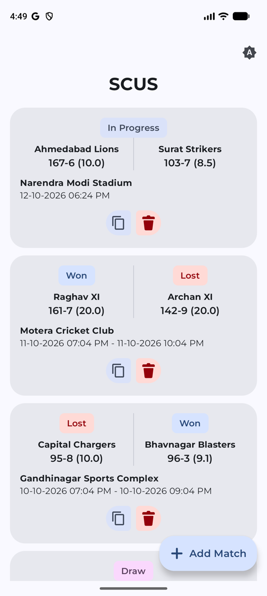
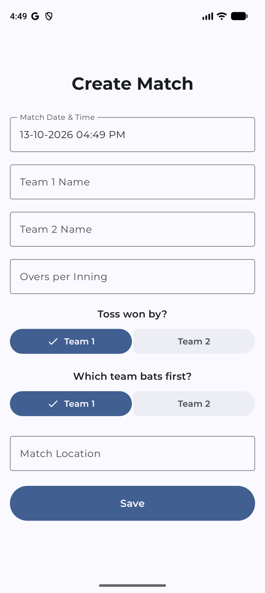
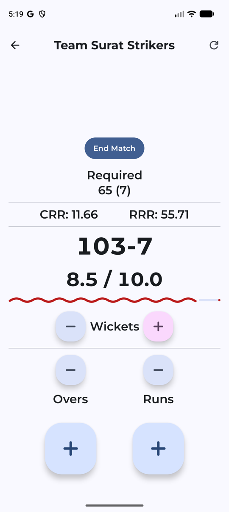
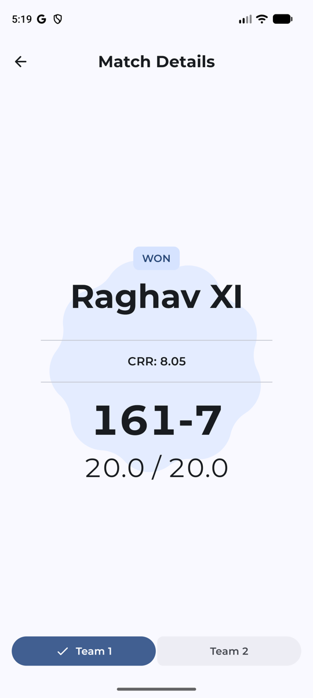
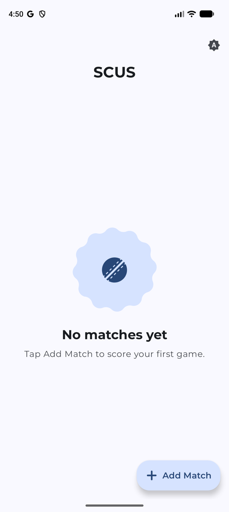
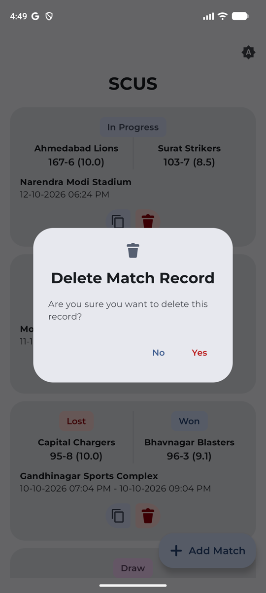

# SCUS — Simple Cricket Umpire Scorer

A scoring app for the umpire or scorer at a local cricket match. Tap once per ball, run or
wicket; the app keeps the score, overs, run rates and the chase, and shows the result when the
match ends. Built with Compose Multiplatform (Android, desktop, iOS) and Material 3 Expressive.

| Matches | New match | Scoring |
| --- | --- | --- |
|  |  |  |

| Result | First run | Delete asks first |
| --- | --- | --- |
|  |  |  |

## Features

- **Match list** with won / lost / draw / in-progress pills; copy a match to start a rematch, delete
  with a confirmation.
- **Create a match**: date and time, team names, overs per inning, toss and batting order in
  connected button groups.
- **Scoring**: large buttons for run, ball and wicket, plainer undo buttons, an innings progress bar
  that turns wavy and red when the chase falls behind the required rate, and a celebration for a
  wicket or every 50 runs.
- **Result**: the winner's score with a slowly turning Material shape behind it; switch teams with
  a connected toggle.
- **Motion**: a card grows into its match screen (container transform), list items cascade in on
  first open, numbers swap without overshoot, and every animation stops when the device has
  animations off. A theme button cycles device / light / dark through a circular reveal.

## Build

```bash
./gradlew :androidCMP:assembleDebug        # Android debug APK
./gradlew :androidCMP:assembleRelease      # Android release APK (needs the signing config)
./gradlew :desktopCMP:run                  # desktop
scripts/ci-local.sh                        # ktfmt + compile, the check before every push
```

Modules: `composeApp` (shared UI and logic), `androidCMP`, `desktopCMP`, `iosApp`; `app` and
`support` are the old Android-only modules being migrated.

## Working on it

Coding agents (Claude Code, Gemini, Codex, Cursor) read [AGENTS.md](AGENTS.md): the rules, the
skills in `.agents/skills/` (UI rules in
[material3-expressive](.agents/skills/material3-expressive/SKILL.md)) and the branch policy. The
agent setup comes from [Android Agent Kit](https://github.com/raghavsatyadev/Android-Agent-Kit).

Tooling: Android Studio Otter | 2025.2.1 Canary 1.
